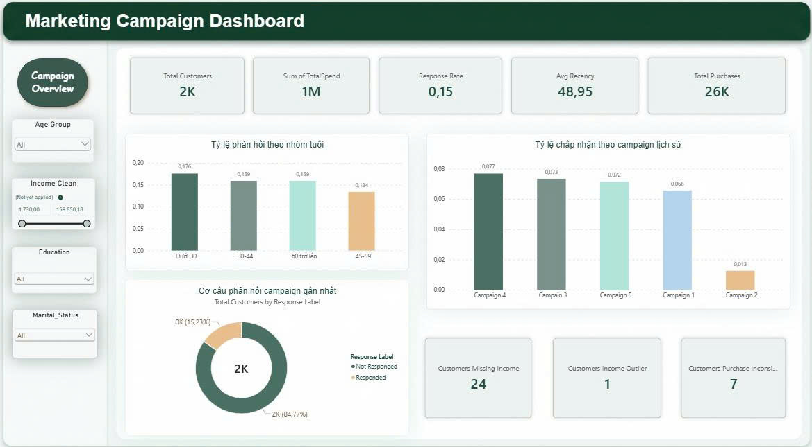
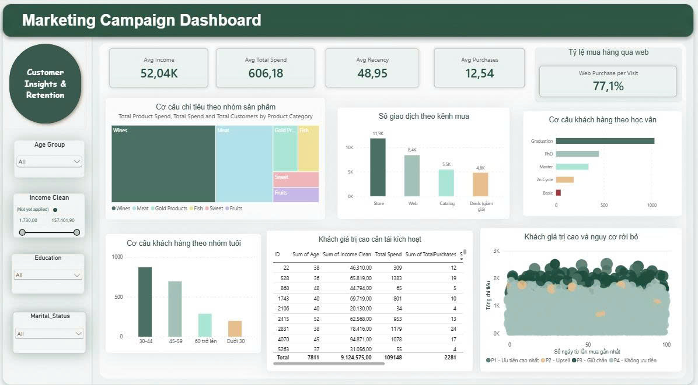
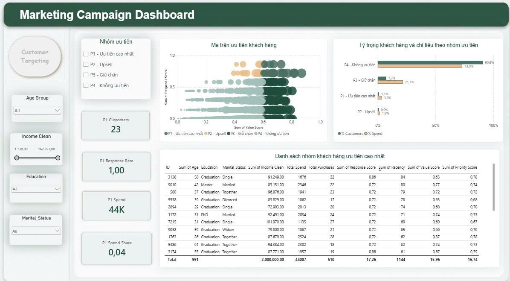

# Phân tích Marketing Campaign: từ làm sạch dữ liệu đến Dashboard Power BI

Phân tích hành vi mua sắm và mức độ phản hồi marketing của 2.055 khách hàng
một chuỗi bán lẻ, từ đó xác định nhóm khách cần ưu tiên cho chiến dịch tiếp theo.

**Công cụ:** Python (pandas, numpy, matplotlib, seaborn) · Power BI · Google Colab

## Bài toán

1. Dữ liệu có đủ tin cậy để ra quyết định không?
2. Các chiến dịch trước đây hiệu quả ra sao?
3. Khách hàng chi tiêu vào đâu, mua qua kênh nào?
4. Nên ưu tiên nhóm khách nào cho chiến dịch tiếp theo?

## Dữ liệu

Marketing Campaign Dataset: 2.240 khách hàng, 29 thuộc tính gồm nhân khẩu học,
chi tiêu theo sản phẩm, hành vi mua theo kênh và phản hồi 6 chiến dịch.
Nguồn: [(https://www.kaggle.com/datasets/rodsaldanha/arketing-campaign/data)]. Sau khi làm sạch còn 2.055 bản ghi.

## Quy trình

1. **Xử lý (Python):** loại 182 bản ghi trùng và 3 năm sinh không hợp lệ,
   chuẩn hóa nhãn tình trạng hôn nhân, gắn cờ (không xóa) thu nhập thiếu hoặc bất thường.
2. **Báo cáo (Power BI):** dashboard 3 trang gồm Campaign Overview,
   Customer Insights & Retention và Customer Targeting.
3. **Cảnh báo:** hàm `check_anomalies()` kiểm tra bất thường của dữ liệu mới.

## Kết quả chính

- Chiến dịch gần nhất đạt tỷ lệ phản hồi **15,2%**, gấp khoảng 2 lần các đợt trước (1,3% đến 7,7%).
- Rượu vang chiếm khoảng 50% và thịt khoảng 28% tổng chi tiêu; cửa hàng là kênh mua chủ đạo.
- Nhóm P3 (Giữ chân): **7,3%** số khách nhưng tạo **21,7%** chi tiêu.
- Nhóm P1 (Ưu tiên cao nhất): 23 khách, chi tiêu trung bình gấp khoảng 3,2 lần mức chung.

Priority Score = 0,6 × Response Score + 0,4 × Value Score

## Dashboard

| Campaign Overview | Customer Insights | Customer Targeting |
|---|---|---|
|  |  |  |

## Cấu trúc thư mục

- `marketing_campaign_analysis.ipynb`: làm sạch dữ liệu và phân tích (Python)
- `Marketing_Campaign_Analyst.pbix`: dashboard Power BI (mở bằng Power BI Desktop)
- `Marketing_Campaign_Report.pdf`: báo cáo đầy đủ
- `data/`: dữ liệu gốc và dữ liệu đã làm sạch
- `images/`: ảnh chụp dashboard

## Hạn chế

Dữ liệu không có chi phí và doanh thu theo từng chiến dịch nên chưa đo được ROI;
phân tích chỉ mang tính mô tả.

## Tác giả

[Đoàn Thị Kim Ánh] · [doankimanh716@gmail.com]
